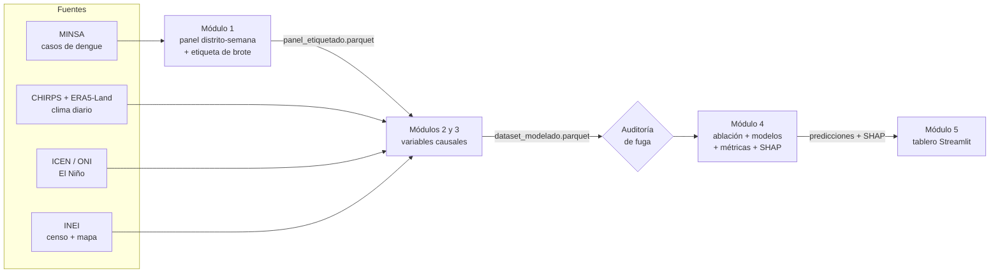

# Alerta temprana explicable de brotes de dengue a nivel distrital (Perú)

[](https://github.com/USUARIO/dengue-alerta-temprana/actions/workflows/ci.yml)


Repositorio del avance experimental de la tesis **"Modelo de machine learning explicable para
la predicción temprana de brotes de dengue a nivel distrital en el Perú a partir de datos de
vigilancia epidemiológica, climáticos y sociodemográficos"** — Ingeniería de Sistemas,
Universidad de Lima.

**Pregunta que responde el sistema:** *¿qué distritos que HOY no tienen brote lo tendrán dentro
de 2 o 4 semanas, y por qué?*

---

## Arquitectura en una imagen



Cada módulo es una carpeta de `src/dengue_alerta/` y se comunica con el siguiente **solo**
mediante un archivo Parquet validado por un contrato (`contratos.py`). Detalle completo en
[`docs/arquitectura.md`](docs/arquitectura.md).

## Inicio rápido (5 minutos)

```bash
git clone https://github.com/USUARIO/dengue-alerta-temprana.git
cd dengue-alerta-temprana
python -m venv .venv
source .venv/bin/activate            # Windows: .venv\Scripts\activate
pip install -e ".[ml,app,dev]"

python -m dengue_alerta sintetico    # datos de prueba con el formato real
python -m dengue_alerta todo         # panel -> features -> auditar -> entrenar -> explicar
streamlit run app/streamlit_app.py   # tablero
pytest                               # 42 pruebas automáticas
```

> ⚠️ Los resultados con datos sintéticos solo demuestran que el software funciona.
> Para usar los datos reales, sigue [`data/README.md`](data/README.md).

## Estructura del repositorio

```
dengue-alerta-temprana/
├── configs/                 # TODOS los parámetros (regla de brote, fechas de corte, modelos)
│   ├── base.yaml
│   └── ci.yaml              # hereda de base; versión liviana para GitHub Actions
├── data/                    # NO se sube a GitHub (ver data/README.md)
│   ├── raw/  external/  interim/  processed/
├── src/dengue_alerta/       # el paquete: toda la lógica vive aquí
│   ├── config.py            # carga YAML con herencia y resuelve rutas
│   ├── contratos.py         # esquema de cada Parquet intermedio
│   ├── io.py                # leer/guardar validando contratos
│   ├── datos/               # una fuente = un archivo (minsa, clima, enso, censo, geografía, sintético)
│   ├── panel/               # Módulo 1: calendario, panel, etiqueta de brote
│   ├── features/            # Módulos 2-3: epidemiológicas, espaciales, climáticas, estructurales
│   ├── modelado/            # Módulo 4: partición, líneas base, modelos, métricas, SHAP, auditoría
│   ├── pipeline.py          # orquestador de etapas
│   └── cli.py               # `python -m dengue_alerta <etapa>`
├── app/                     # Módulo 5: tablero Streamlit
├── tests/                   # pruebas automáticas (incluye anti-fuga)
├── notebooks/               # exploración y presentación (importan del paquete)
├── scripts/gee/             # extracción de clima en Google Earth Engine
├── docs/                    # arquitectura, guía paso a paso, decisiones (ADR)
├── reports/                 # métricas y figuras generadas (no se suben)
├── models/                  # modelos entrenados (no se suben)
├── .github/                 # CI, plantillas de issues y pull requests
├── pyproject.toml           # dependencias + configuración de ruff y pytest
└── Makefile                 # atajos: make pipeline, make test, make app...
```

## Comandos

| Comando | Qué hace | Salida principal |
|---|---|---|
| `python -m dengue_alerta sintetico` | Genera datos de prueba | `data/raw`, `data/external` |
| `python -m dengue_alerta panel` | Módulo 1 | `data/interim/panel_etiquetado.parquet` |
| `python -m dengue_alerta features` | Módulos 2 y 3 | `data/processed/dataset_modelado.parquet` |
| `python -m dengue_alerta auditar` | Prueba de perturbación del futuro | `reports/metricas/auditoria_fuga.json` |
| `python -m dengue_alerta entrenar` | Ablación × modelos × horizontes | `reports/metricas/resultados.csv` |
| `python -m dengue_alerta explicar` | SHAP del modelo final | `data/processed/shap_test.parquet` |
| `python -m dengue_alerta tunear --horizonte 2` | Optuna sobre LightGBM | `reports/metricas/mejores_hiperparametros_*.yaml` |
| `python -m dengue_alerta todo` | Todo lo anterior en cadena | — |

Todas aceptan `--config configs/otro.yaml`.

## Decisiones metodológicas clave

| Decisión | Dónde | Por qué |
|---|---|---|
| Brote = ≥5 casos en ≥3 semanas consecutivas; termina tras 2 semanas sin casos | `configs/base.yaml` → `etiqueta` | Definición reproducible (Dostal et al., 2022) |
| Etiqueta retrospectiva solo como objetivo; estado en tiempo real como predictor | `panel/etiquetas.py` | Evita usar el futuro |
| Partición temporal train ≤ 2021 / val 2022 / test 2023 con frontera t+h | `modelado/particion.py` | Evaluación honesta |
| Evaluación separada en distritos **sin brote hoy** | `modelado/metricas.py` | Ahí está el valor de una alerta temprana |
| ICEN con 2 meses de rezago de publicación | `datos/enso.py` | El dato del mes m no existe en el mes m |
| Auditoría automática de fuga en cada PR | `tests/test_fuga.py` | Kapoor y Narayanan (2023) |

Más detalle en [`docs/decisiones/`](docs/decisiones/).

## Documentación

- [`docs/GUIA_PASO_A_PASO.md`](docs/GUIA_PASO_A_PASO.md) — de cero a GitHub: entorno, flujo de trabajo, ramas, commits, CI, datos reales.
- [`docs/arquitectura.md`](docs/arquitectura.md) — cómo funciona cada componente y cómo interactúan.
- [`CONTRIBUTING.md`](CONTRIBUTING.md) — convenciones de código, commits y Pull Requests.

## Cómo citar

> Apellido, N. (2026). *Modelo de machine learning explicable para la predicción temprana de
> brotes de dengue a nivel distrital en el Perú* [Software]. GitHub.
> https://github.com/USUARIO/dengue-alerta-temprana
