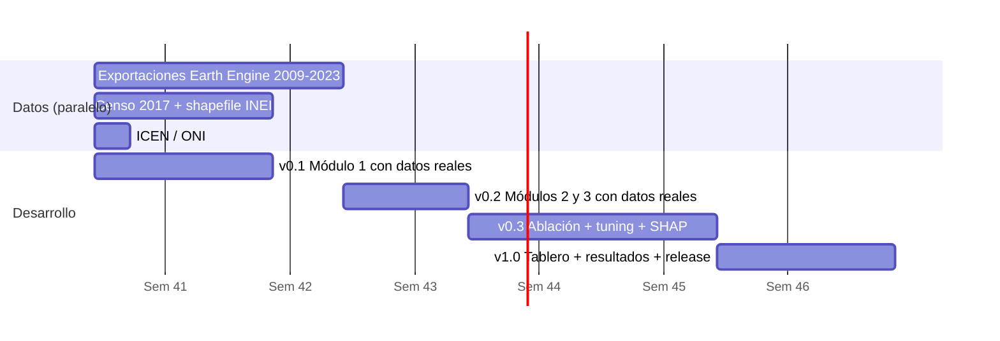
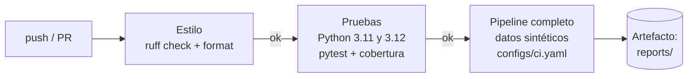

# Guía paso a paso del avance experimental

> De una carpeta vacía a un repositorio en GitHub con integración continua, y de ahí a los
> resultados de la tesis. Cada paso dice **qué** hacer, **dónde** y **por qué**.

**Contenido**

0. [El plan: qué se construye y en qué orden](#0-el-plan)
1. [Herramientas](#1-herramientas)
2. [Subir el proyecto a GitHub](#2-subir-el-proyecto-a-github)
3. [Entorno local y primera ejecución](#3-entorno-local-y-primera-ejecución)
4. [Configurar GitHub como centro de control](#4-configurar-github)
5. [El ciclo diario de desarrollo (ejemplo completo)](#5-el-ciclo-diario-de-desarrollo)
6. [Cómo funciona la integración continua](#6-integración-continua)
7. [Cómo funciona el sistema por dentro](#7-cómo-funciona-el-sistema-por-dentro)
8. [Pasar de datos sintéticos a datos reales](#8-pasar-a-datos-reales)
9. [Experimentos trazables](#9-experimentos-trazables)
10. [Versiones y entregas](#10-versiones-y-entregas)
11. [Errores frecuentes](#11-errores-frecuentes)
12. [Qué mostrar en la revisión del avance](#12-qué-mostrar-en-la-revisión)

---

## 0. El plan

### 0.1 Estado actual

| Módulo | Código | Pruebas | Con datos reales |
|---|---|---|---|
| 1 · Panel y etiqueta de brote | ✅ | ✅ | ⏳ falta descargar el CSV |
| 2 · Clima y El Niño | ✅ | ✅ | ⏳ falta la extracción en Earth Engine |
| 3 · Vecinos y estructurales | ✅ | ✅ | ⏳ falta shapefile y censo |
| 4 · Modelos, métricas, SHAP | ✅ | ✅ | ⏳ depende de 1–3 |
| 5 · Tablero | ✅ | ✅ (prueba de humo) | ⏳ depende de 4 |

Todo el pipeline ya corre de punta a punta con **datos sintéticos que tienen exactamente el
formato de las fuentes reales**. Pasar a datos reales es reemplazar archivos en `data/`,
no reescribir código.

### 0.2 Hoja de ruta optimizada

La optimización clave: **la ruta crítica no es el código, son los datos**. La extracción de
clima en Earth Engine tarda horas por año y la tabulación del censo es manual, así que se
inician en la semana 1, en paralelo, mientras se valida el Módulo 1.



| Hito | Entregable verificable | Criterio de aceptación |
|---|---|---|
| **v0.1** | Panel real 2010–2023 y etiqueta validada | `resumen_panel.json` + coincidencia con salas situacionales del CDC en 2017 y 2023 |
| **v0.2** | Dataset de modelado completo | `auditoria_fuga.json` sin variables cambiadas |
| **v0.3** | Tabla de ablación y SHAP | PR-AUC en `sin_brote_hoy` por encima de ambas líneas base |
| **v1.0** | Tablero publicado y release citable | Tag `v1.0.0`, CI en verde, resultados en el documento |

> Ajusta las fechas al calendario del curso; los hitos ya están creados como *milestones*
> por `scripts/github_setup.sh`.

---

## 1. Herramientas

| Herramienta | Para qué | Instalación |
|---|---|---|
| **Python 3.11** | Lenguaje del proyecto | python.org (marcar *Add to PATH* en Windows) |
| **Git** | Control de versiones | git-scm.com |
| **Cuenta de GitHub** | Repositorio remoto, CI, issues | github.com (con el correo de la universidad obtienes GitHub Education gratis) |
| **GitHub CLI (`gh`)** | Crear repos, issues y PR desde la terminal | cli.github.com |
| **VS Code** | Editor | code.visualstudio.com + extensiones *Python*, *Ruff*, *Jupyter*, *GitLens* |
| **Cuenta de Google Earth Engine** | Extraer clima por distrito | earthengine.google.com (registro académico gratuito) |

Verifica en una terminal:

```bash
python --version   # 3.10 o superior
git --version
gh --version
```

---

## 2. Subir el proyecto a GitHub

### 2.1 Identidad de Git (una sola vez por computadora)

```bash
git config --global user.name "Tu Nombre Apellido"
git config --global user.email "aylenespinoz4@gmail.com"   # el mismo correo de tu cuenta GitHub
git config --global init.defaultBranch main
```

### 2.2 Crear el repositorio local

Descomprime `dengue-alerta-temprana.zip`, entra a la carpeta y:

```bash
cd dengue-alerta-temprana
git init
git add .
git status          # revisa: NO debe aparecer nada dentro de data/, models/ ni reports/
git commit -m "chore: estructura inicial del proyecto y Módulo 1"
```

> **¿Por qué revisar `git status` antes del primer commit?** Lo que entra al historial de
> Git se queda ahí para siempre, aunque luego lo borres. Si un CSV de 200 MB entra por
> error, el repositorio queda inflado. El `.gitignore` ya lo impide, pero es buena costumbre
> mirar.

### 2.3 Crear el repositorio remoto y subir

Con GitHub CLI (recomendado):

```bash
gh auth login                                   # una sola vez; elige HTTPS y navegador
gh repo create dengue-alerta-temprana --private --source=. --remote=origin --push
```

O desde la web: *New repository* → nombre `dengue-alerta-temprana` → **sin** README ni
.gitignore (ya los tienes) → y luego:

```bash
git remote add origin https://github.com/TU_USUARIO/dengue-alerta-temprana.git
git push -u origin main
```

> **¿Privado o público?** Privado mientras desarrollas. Al final, público (y con DOI de
> Zenodo) para que el jurado pueda verificar la reproducibilidad. Los datos nunca se suben,
> así que no hay riesgo de exponer información de pacientes.

Finalmente reemplaza `USUARIO` en los enlaces del `README.md` y `Nombre Apellido` en
`pyproject.toml` y `LICENSE`, y haz tu segundo commit:

```bash
git commit -am "docs: completar usuario y autoría"
git push
```

---

## 3. Entorno local y primera ejecución

### 3.1 Entorno virtual

Un entorno virtual es una "caja" con las versiones exactas de las librerías de este
proyecto, separada del resto de tu computadora.

```bash
python -m venv .venv
# Activar:
source .venv/bin/activate        # macOS / Linux
.venv\Scripts\activate           # Windows (PowerShell)
```

Sabrás que está activo porque la terminal muestra `(.venv)` al inicio. En VS Code:
`Ctrl+Shift+P` → *Python: Select Interpreter* → `.venv`.

### 3.2 Instalar el proyecto

```bash
pip install --upgrade pip
pip install -e ".[ml,app,dev]"
pre-commit install
```

- `-e` (editable): instala tu paquete apuntando a `src/`. Cualquier cambio en el código se
  refleja al instante, sin reinstalar.
- `[ml,app,dev]`: grupos opcionales declarados en `pyproject.toml` (LightGBM/SHAP, Streamlit,
  herramientas de desarrollo). `[geo]` (geopandas) solo se necesita para generar la
  adyacencia desde el shapefile.
- `pre-commit install`: desde ahora, cada `git commit` revisa estilo, archivos grandes y
  limpia notebooks **antes** de guardar el commit.

### 3.3 Verificar que todo funciona

```bash
pytest                                # 42 passed
python -m dengue_alerta sintetico     # crea data/raw y data/external
python -m dengue_alerta todo          # ~1.5 min
streamlit run app/streamlit_app.py    # abre http://localhost:8501
```

Si todo pasa, tu máquina reproduce exactamente lo mismo que la CI de GitHub.

---

## 4. Configurar GitHub

### 4.1 Proteger la rama `main`

*Settings → Branches → Add branch ruleset* (o *Add rule*) para `main`:

- ✅ Require a pull request before merging
- ✅ Require status checks to pass → seleccionar **Estilo (ruff)**, **Pruebas**, **Pipeline completo**
- ✅ Block force pushes

Resultado: `main` siempre funciona. Nada entra sin pasar las pruebas, ni siquiera tus
propios cambios apurados a las 2 a. m.

### 4.2 Etiquetas, hitos y tareas iniciales (automático)

```bash
bash scripts/github_setup.sh
```

Crea las etiquetas por módulo, los cuatro hitos (v0.1 … v1.0) y diez issues iniciales con
sus criterios de aceptación.

### 4.3 Tablero Kanban

*Projects → New project → Board*. Columnas: **Por hacer · En progreso · En revisión · Hecho**.
Agrega los issues. GitHub mueve las tarjetas solo cuando abres o fusionas un PR.

> **Para la tesis:** el tablero y los hitos son evidencia objetiva de planificación y
> avance. Una captura del tablero es una figura válida para la sección de metodología.

---

## 5. El ciclo diario de desarrollo

Ejemplo real: **agregar los casos de los vecinos con rezago de 2 semanas** (issue #11).

### Paso 1 · Partir de `main` actualizado y crear rama

```bash
git switch main
git pull
git switch -c feat/11-vecinos-lag2
```

### Paso 2 · Escribir primero la prueba (lo que esperas que pase)

`tests/test_features.py`:

```python
def test_vecinos_lag2_es_el_valor_de_hace_dos_semanas():
    fechas = pd.date_range("2020-01-05", periods=4, freq="7D")
    panel = pd.DataFrame({
        "ubigeo": ["000001"] * 4 + ["000002"] * 4,
        "fecha": list(fechas) * 2,
        "casos": [0, 0, 0, 0, 5, 6, 7, 8],
        "brote_rt": 0,
    })
    ady = pd.DataFrame({"ubigeo": ["000001"], "vecino": ["000002"]})
    p, cols = espaciales.agregar(panel, ady)
    d1 = p[p["ubigeo"] == "000001"]
    assert "vec_casos_lag2" in cols
    assert d1["vec_casos_lag2"].tolist()[2:] == [5, 6]
```

```bash
pytest tests/test_features.py -k lag2     # falla (rojo): la variable aún no existe
```

### Paso 3 · Implementar lo mínimo

`src/dengue_alerta/features/espaciales.py`:

```python
p["vec_casos_lag2"] = g.shift(2)
nuevas = ["vec_casos", "vec_casos_lag1", "vec_casos_lag2", "vec_casos_4s", ...]
```

```bash
pytest tests/test_features.py -k lag2     # pasa (verde)
pytest                                    # TODO sigue pasando, incluida la prueba anti-fuga
```

### Paso 4 · Commit

```bash
git add -A
git commit -m "feat(features): agregar casos de vecinos con rezago de 2 semanas

El contagio entre distritos tarda 1-3 semanas; lag1 solo cubría parte.

Cierra #11"
```

`pre-commit` corre ruff. Si corrige algo, vuelve a hacer `git add -A` y repite el commit.

### Paso 5 · Subir y abrir Pull Request

```bash
git push -u origin feat/11-vecinos-lag2
gh pr create --fill
```

La plantilla del PR aparece con la lista de verificación. GitHub Actions empieza a correr.

### Paso 6 · Revisar y fusionar

1. En la pestaña *Files changed*, lee tu propio diff como si fuera de otra persona.
2. Espera los tres checks en verde ✅.
3. **Squash and merge** → un solo commit limpio en `main`.
4. *Delete branch*. El issue #11 se cierra solo.

```bash
git switch main && git pull && git branch -d feat/11-vecinos-lag2
```

> **¿Por qué tanto proceso si trabajo sola?** Porque (1) `main` siempre funciona y puedes
> mostrarla en cualquier momento; (2) cada resultado de la tesis queda ligado a un commit
> exacto; (3) si algo se rompe, `git log` dice cuándo y por qué; (4) es exactamente como se
> trabaja en la industria, y eso se nota en la sustentación.

---

## 6. Integración continua

Archivo: `.github/workflows/ci.yml`. Se dispara en cada push a `main` y en cada PR.



| Job | Qué verifica | Si falla… |
|---|---|---|
| **Estilo** | Formato y errores comunes | `ruff check --fix . && ruff format .` en local |
| **Pruebas** | 42 pruebas, incluidas regla de brote, partición y **anti-fuga**, en dos versiones de Python | Lee el nombre de la prueba que falló: dice qué regla se rompió |
| **Pipeline** | Que todas las etapas encajen de punta a punta | Revisa qué etapa falló en el log; suele ser un contrato |

Las métricas y figuras de cada ejecución quedan descargables en *Actions → ejecución →
Artifacts → reportes-ci*.

**Insignia:** el badge del README se vuelve verde cuando la CI pasa en `main`.

---

## 7. Cómo funciona el sistema por dentro

### 7.1 La vida de una alerta

Sigamos una sola fila: **distrito 200101, semana del 5 de marzo de 2023, horizonte 2**.

1. **`datos/minsa.py`** lee los 47 casos individuales de ese distrito en esa semana; descarta
   3 sospechosos; el ubigeo `200101` se recupera de `200101.0`.
2. **`panel/calendario.py`** convierte (2023, SE 10) en el domingo 5/3/2023.
3. **`panel/construir.py`** cuenta 44 casos y asegura que las semanas sin casos existan con 0.
4. **`panel/etiquetas.py`** calcula:
   - `brote_rt = 0` (con lo que se sabía el 5/3, la regla aún no se había cumplido)
   - `brote` de la semana 19/3 = 1 (mirando el año completo, esa semana fue parte de un brote)
   - `y_h2 = 1` → **esto es lo que el modelo debe adivinar el 5/3**.
5. **`features/`** agrega ~40 variables: casos de las últimas 8 semanas, vecinos, lluvia de
   las 4 semanas que terminaron el 19/2, temperatura de hace 2–8 semanas, ICEN de enero
   (publicado en marzo), población sin agua de red.
6. **`modelado/particion.py`** la ubica en **prueba** (fecha > 31/12/2022).
7. **`modelado/entrenar.py`**: el LightGBM entrenado con 2010–2021 le asigna riesgo 0.81;
   el umbral elegido en 2022 es 0.42 → **alerta = 1**. Como `y_h2 = 1`, es un acierto
   **anticipado** (hoy no hay brote, en 2 semanas sí).
8. **`modelado/explicar.py`**: SHAP dice que la lluvia acumulada (+0.9), los casos de los
   vecinos (+0.6) y la temperatura (+0.4) empujaron el riesgo hacia arriba.
9. **`app/`** muestra el distrito en rojo en el mapa, primero en el ranking, con su
   explicación.

*(Números ilustrativos.)*

### 7.2 ¿Por qué esta separación en capas?

```
          ┌─────────────────────────────┐
  CLI     │ cli.py → pipeline.py         │  orquesta: qué etapa, en qué orden, con qué config
          ├─────────────────────────────┤
  Lógica  │ panel/ features/ modelado/   │  funciones puras: DataFrame entra, DataFrame sale
          ├─────────────────────────────┤
  Datos   │ datos/  io.py  contratos.py  │  leer, validar, escribir
          ├─────────────────────────────┤
  Config  │ config.py + configs/*.yaml   │  todos los parámetros
          └─────────────────────────────┘
```

- La **lógica** no lee archivos → se prueba con DataFrames de 5 filas escritos a mano.
- Los **adaptadores de datos** aíslan cada fuente → si el MINSA cambia el nombre de una
  columna, se toca un solo diccionario (`datos/minsa.py → COLUMNAS`).
- La **orquestación** es delgada → se entiende leyendo `pipeline.py` en 2 minutos.

### 7.3 Los tres patrones que conviene saber explicar

| Patrón | Dónde | Explicación en una frase |
|---|---|---|
| **Contrato de datos** | `contratos.py` | Cada archivo intermedio declara sus columnas y llave; si alguien rompe el formato, falla de inmediato y en el lugar correcto. |
| **Fábrica (factory)** | `modelado/modelos.py` | El entrenamiento pide un modelo por su nombre del YAML; agregar uno nuevo no toca el resto del código. |
| **Registro de grupos** | `features/dataset.py` + `grupos_features.json` | Cada variable sabe a qué grupo pertenece; así la ablación E1→E4 es solo una lista en el YAML. |

### 7.4 La prueba anti-fuga, explicada

```
Datos originales:        ... 3  5  8 | 12 20 31 ...
Datos con futuro alterado:... 3  5  8 | 40 2  77 ...
                                    ▲ corte
Variables hasta el corte: deben ser IDÉNTICAS  → si no, la variable mira el futuro
Etiqueta hasta el corte:  puede cambiar        → es retrospectiva, solo se usa como objetivo
```

Se ejecuta en cada PR (`tests/test_fuga.py`) y en el pipeline (`etapa_auditar`). Además se
verificó que **sí detecta** una variable tramposa (`shift(-1)`): la marca como fuga.

---

## 8. Pasar a datos reales

1. **Casos (MINSA).** Descargar el CSV de vigilancia de dengue desde datosabiertos.gob.pe y
   guardarlo como `data/raw/vigilancia_dengue.csv`. Abrir las primeras líneas para confirmar
   separador y nombres de columnas; si difieren, ajustar `COLUMNAS` en `datos/minsa.py`.
2. **Borrar lo sintético:** `make limpiar` y eliminar los CSV sintéticos de `data/external/`.
3. **Módulo 1:** `python -m dengue_alerta panel` → revisar `reports/metricas/resumen_panel.json`
   (número de distritos, % de semanas en brote, retraso de detección) y anotarlo en el issue.
4. **Clima:** en code.earthengine.google.com, subir el shapefile de distritos del INEI como
   *asset*, pegar `scripts/gee/clima_distrital.js`, cambiar la ruta del asset y ejecutar.
   Lanzar las tareas (pestaña *Tasks*), descargar los CSV de Drive y unirlos:
   ```python
   import pandas as pd, glob
   pd.concat(map(pd.read_csv, glob.glob("clima_distrital_*.csv"))).to_csv(
       "data/external/clima_distrital_diario.csv", index=False)
   ```
5. **ENSO:** tabla mensual del ICEN (IGP) → `data/external/indices_enso.csv` con columnas
   `anio, mes, icen` (y `oni` si se agrega).
6. **Geografía:** `pip install -e ".[geo]"` y luego
   ```python
   from pathlib import Path
   from dengue_alerta.datos.geografia import adyacencia_desde_shapefile
   ady = adyacencia_desde_shapefile(Path("ruta/DISTRITOS.shp"),
                                    ruta_geojson=Path("data/external/distritos.geojson"))
   ady.to_csv("data/external/adyacencia_distritos.csv", index=False)
   ```
7. **Estructurales:** tabular Censo 2017 (REDATAM) + altitud media SRTM por distrito →
   `data/external/estructurales_distritales.csv`.
8. `python -m dengue_alerta todo` y abrir el tablero.

> Si alguna fuente aún no está lista, `features` la omite con un aviso y el resto funciona:
> puedes avanzar el modelado solo con variables epidemiológicas (E1) mientras tanto.

---

## 9. Experimentos trazables

**Regla:** un experimento = un YAML en `configs/experimentos/` + un issue con la plantilla
*Experimento* + un PR. Ejemplo incluido: `sensibilidad_brote_4semanas.yaml` (hereda todo de
`base.yaml` y solo cambia `min_semanas` y las carpetas de salida).

```bash
python -m dengue_alerta todo --config configs/experimentos/sensibilidad_brote_4semanas.yaml
```

**MLflow (opcional):** poner `modelado.mlflow: true` en el YAML, ejecutar y luego
`mlflow ui` → http://localhost:5000 para comparar corridas lado a lado.

**Optuna:** `python -m dengue_alerta tunear --horizonte 2 --trials 60` escribe
`reports/metricas/mejores_hiperparametros_lightgbm_h2.yaml`. Revisar, copiar a
`configs/base.yaml` y hacer commit `exp(config): hiperparámetros LightGBM h=2 (Optuna)`.

**Del resultado a la tesis:** `notebooks/01_resultados.ipynb` arma la tabla de ablación y
la figura comparativa a partir de `reports/metricas/resultados.csv`.

---

## 10. Versiones y entregas

Versionado semántico ligado a los hitos:

| Tag | Momento |
|---|---|
| `v0.1.0` | Avance experimental 1: estructura + Módulo 1 |
| `v0.2.0` | Módulos 2 y 3 con datos reales |
| `v0.3.0` | Resultados de modelado y SHAP |
| `v1.0.0` | Versión de la sustentación |

```bash
# actualizar CHANGELOG.md, luego:
git tag -a v0.1.0 -m "Avance experimental 1: estructura del proyecto y Módulo 1"
git push origin v0.1.0
gh release create v0.1.0 --title "v0.1.0 · Avance experimental 1" --notes-file CHANGELOG.md
```

Para `v1.0.0`: conectar el repositorio con **Zenodo** (zenodo.org → GitHub → activar el
repo) antes de crear el release; Zenodo genera un **DOI** citable en la tesis.

---

## 11. Errores frecuentes

| Síntoma | Causa | Solución |
|---|---|---|
| `ModuleNotFoundError: dengue_alerta` | Entorno no activado o paquete no instalado | Activar `.venv` y `pip install -e .` |
| `FileNotFoundError ... Ejecuta primero la etapa anterior` | Falta la salida de la etapa previa | Correr la etapa indicada o `todo` |
| `ErrorContrato: hay ubigeos que no tienen 6 dígitos` | Ubigeo leído como número | Revisar el lector de esa fuente; usar `normalizar_ubigeo` |
| `ErrorContrato: N filas repetidas en la llave` | Un merge duplicó filas | Revisar la tabla externa (p. ej. un distrito repetido en el censo) |
| `RuntimeError: FUGA DE INFORMACIÓN en [...]` | Una variable usa datos futuros | Revisar `shift`/`rolling` de esa variable (¿shift negativo? ¿rolling sin agrupar por distrito?) |
| `pre-commit` modifica archivos y el commit no se hace | Ruff corrigió formato | `git add -A` y repetir el commit |
| CI falla solo en Python 3.12 | Diferencia de versión de una librería | Leer el log; fijar versión mínima en `pyproject.toml` |
| `git push` rechazado en `main` | Rama protegida | Correcto: trabaja en una rama y abre PR |

---

## 12. Qué mostrar en la revisión

1. **El repositorio** en GitHub: README, estructura, historial de commits con mensajes claros.
2. **La CI en verde** y el log del job *Pipeline completo* (todas las etapas en ~1 min).
3. **`pytest -v`** en vivo, deteniéndose en `test_ejemplo_a_mano_*` y `test_fuga.py`.
4. **`auditoria_fuga.json`**: 0 variables cambiadas; las etiquetas sí cambian (control positivo).
5. **La tabla de ablación** (notebook 01): cada grupo de variables suma, y todos superan la
   persistencia en distritos sin brote hoy.
6. **El tablero**: mapa → ranking → "¿por qué?" de un distrito.
7. **El tablero Kanban y los hitos**: planificación verificable.

Frase de cierre sugerida: *"Todo lo que acaban de ver se reconstruye desde cero con un
solo comando, y cada resultado está ligado a un commit y a una configuración."*
