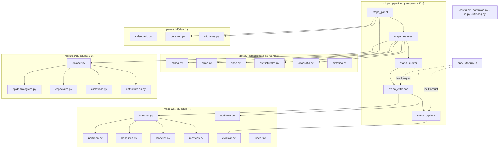

# Arquitectura del sistema

## 1. Principios de diseño

| Principio | Cómo se aplica aquí |
|---|---|
| **Una responsabilidad por archivo** | `datos/minsa.py` solo sabe leer y limpiar el CSV del MINSA; no sabe nada de modelos. |
| **Comunicación por contratos** | Los módulos no se llaman entre sí: uno escribe un Parquet, el siguiente lo lee. `contratos.py` valida columnas, tipos y llave en cada lectura/escritura. |
| **Configuración fuera del código** | Umbrales, fechas y modelos viven en `configs/*.yaml`. Un experimento = un YAML. |
| **Causalidad por construcción** | Toda variable de la semana *t* usa solo datos ≤ *t*. Se verifica con una prueba automática de perturbación del futuro. |
| **Reproducibilidad** | Semilla fija, partición determinista, dependencias declaradas en `pyproject.toml`, CI que corre todo de cero. |
| **Dependencias opcionales diferidas** | `lightgbm`, `shap`, `geopandas`, `mlflow` se importan dentro de la función que los usa. El núcleo funciona sin ellos. |

## 2. Vista de componentes

## 3. Flujo de datos y contratos

| # | Etapa | Lee | Escribe | Contrato (llave) |
|---|---|---|---|---|
| 1 | `panel` | `raw/vigilancia_dengue.csv` | `interim/casos_limpios.parquet` | `CASOS` |
| | | | `interim/panel_etiquetado.parquet` | `PANEL` (ubigeo, fecha) |
| 2 | `features` | panel + `external/*.csv` | `interim/clima_semanal.parquet` | `CLIMA_SEMANAL` (ubigeo, fecha) |
| | | | `processed/dataset_modelado.parquet` + `grupos_features.json` | `DATASET` (ubigeo, fecha) |
| 3 | `auditar` | panel + adyacencia | `reports/metricas/auditoria_fuga.json` | — |
| 4 | `entrenar` | dataset + panel | `models/*.joblib`, `reports/metricas/resultados.csv`, `processed/predicciones_test.parquet` | `PREDICCIONES` (ubigeo, fecha, horizonte, experimento, modelo) |
| 5 | `explicar` | dataset + modelo final | `processed/shap_test.parquet`, figuras | — |
| 6 | tablero | predicciones + dataset + SHAP + GeoJSON | — | — |

**¿Por qué Parquet y no CSV?** Conserva los tipos (el ubigeo sigue siendo texto, la fecha
sigue siendo fecha), es columnar (leer 5 de 60 columnas es rápido) y pesa ~10 veces menos.

## 4. Lógica de cada componente

### Módulo 1 — `panel/`

1. **`datos/minsa.py → limpiar`**: renombra columnas, ubigeo a 6 dígitos, solo dengue, solo
   tipos C y P, semanas 1–53.
2. **`calendario.py`**: (año, semana epidemiológica) → domingo de inicio. Maneja años de 53
   semanas y la semana 1 que empieza en diciembre.
3. **`construir.py`**: cuenta casos por distrito-semana y **rellena con ceros** la grilla
   completa (sin esto los rezagos saltarían semanas).
4. **`etiquetas.py`**:
   - `etiquetar_brotes` (retrospectiva) → columna `brote` → objetivo `y_h{h}` = `brote` desplazado *h* semanas.
   - `brote_en_tiempo_real` (causal) → `brote_rt` → predictor y filtro `sin_brote_hoy`.
   - `retraso_de_deteccion` → cuántas semanas tarda la regla en "ver" un brote: la ventana que el modelo intenta adelantar.

### Módulos 2 y 3 — `features/`

Cada archivo expone `agregar(panel, ...) -> (panel_ampliado, columnas_nuevas)`.
`dataset.py` los llama en orden y guarda qué columnas pertenecen a qué grupo
(`grupos_features.json`), que es lo que permite la **ablación**.

| Grupo | Variables | Lógica temporal |
|---|---|---|
| epidemiológicas | `casos_lag0..7`, `casos_4s/12s/52s`, `tendencia_4s`, `razon_4s`, `brote_rt`, `sem_desde_brote`, `sem_sin/cos` | ventanas que terminan en *t* |
| espaciales | `vec_casos`, `vec_casos_lag1`, `vec_casos_4s`, `vec_tendencia`, `vec_en_brote` | vecinos en *t* (ya observados) |
| climáticas | `precip/temp/hum_lag{2,4,6,8}`, `precip_4s_lag2`, `precip_anom_lag2`, `enso_icen` | solo rezagos; ICEN con 2 meses de rezago de publicación |
| estructurales | `log_densidad`, `altitud_m`, `pct_sin_agua_red`, `pct_sin_desague`, `pct_hacinamiento` | constantes (censo 2017) |

### Módulo 4 — `modelado/`

- **`particion.py`**: train/val/test por fecha, exigiendo que la *fecha objetivo* (t+h) caiga dentro del periodo.
- **`baselines.py`**: persistencia y estacional ingenua (el piso que hay que superar).
- **`modelos.py`**: fábrica `crear_modelo(nombre, params, semilla, y)`; aplica pesos por desbalance.
- **`metricas.py`**: PR-AUC, ROC-AUC, F1 con umbral de validación, precisión@k, Brier; todo en *total* y *sin_brote_hoy*.
- **`entrenar.py`**: bucle horizontes × experimentos × modelos; guarda modelos, métricas y predicciones; registra en MLflow si está activado.
- **`explicar.py`**: SHAP (TreeExplainer) del modelo final: importancia global, figura y top-8 contribuciones por distrito-semana.
- **`auditoria.py`**: prueba de perturbación del futuro (debe reportar 0 variables cambiadas).
- **`tunear.py`**: Optuna (TPE) sobre validación; escribe un YAML para revisión humana.

### Módulo 5 — `app/`

`carga.py` lee los Parquet (sin entrenar nada) y `streamlit_app.py` arma cuatro pestañas:
mapa de riesgo, ranking top-k de distritos sin brote hoy, explicación SHAP por distrito y
repetición semana a semana del periodo de prueba.

## 5. Cómo extender el sistema

| Quiero… | Toco solo… |
|---|---|
| Probar otra definición de brote | `configs/*.yaml` → `etiqueta` |
| Agregar un grupo de variables (p. ej. movilidad) | nuevo `features/movilidad.py` + 2 líneas en `dataset.py` + nombre en `experimentos` |
| Agregar un modelo (p. ej. CatBoost, LSTM) | una función en `modelos.py` + su nombre en el YAML |
| Cambiar el periodo de prueba | `configs/*.yaml` → `particion` |
| Usar datos de 2024–2026 (Ley 27806) | reemplazar `data/raw/vigilancia_dengue.csv` y mover las fechas de corte |
